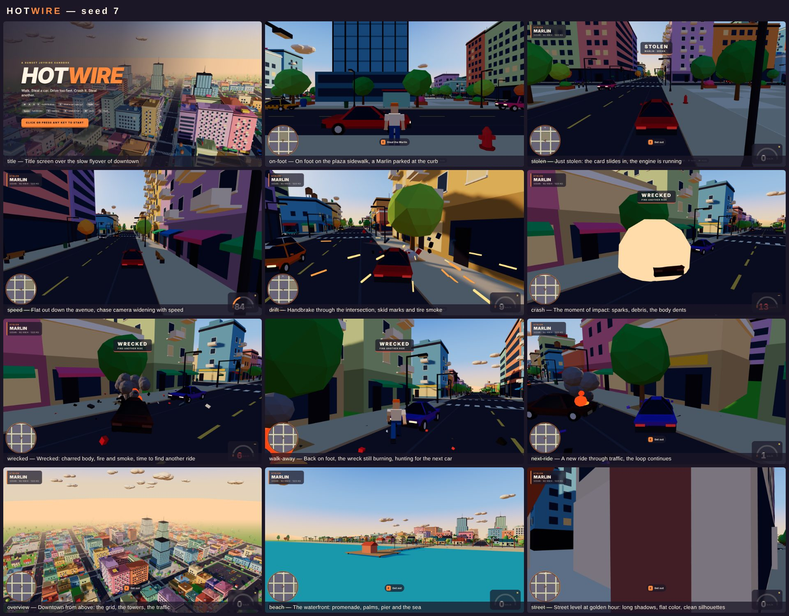

# HOTWIRE

**A sunlit, low-poly open-world driving sandbox that runs in the browser.**

You are dropped into a small, colorful city at golden hour. You walk, steal almost any car you
see, drive too fast through traffic, crash, wreck the car, get out, steal another, and keep
going. That loop is the whole game. No missions, weapons, police, pedestrians, story or music.



## Play

```bash
npm install        # only needed for the headless tools (Playwright); the game itself has no dependencies
npm start          # serves the game at http://localhost:8080
```

Any static file server works too (`npx serve .`, `python3 -m http.server`); there is no build
step. Three.js is vendored into `vendor/`.

| Key | Action |
| --- | --- |
| `W A S D` / arrows | walk, drive (W throttle, S brake / reverse) |
| `Shift` | run |
| `Space` | handbrake |
| `E` (`Enter`, `F`) | steal the car you are next to / get out |
| `C` | camera: chase, far, hood |
| `R` | straighten a stuck car onto the road |
| `H` | horn |
| `M` | mute |
| `Esc` / `P` | pause |
| mouse drag / wheel | orbit / zoom the camera |

URL options: `?seed=42` (a different city and traffic), `?demo=1` (an autopilot plays the whole
loop until you press a key), `?autostart=1` (skip the title), `?mute=1`.

## What is in the box

- **A procedural city** — 8×8 grid of streets with themed blocks: downtown towers on a plaza,
  mid-rise shop streets with awnings and balconies, residential blocks with gabled houses and
  lawns, a park, parking lots, gas stations, a palm-lined waterfront with a pier. Everything is
  built from boxes, tapered boxes and icospheres and baked into a handful of flat-shaded,
  vertex-colored meshes per block. No textures anywhere.
- **One committed time of day** — a low warm sun with long shadows (4096 PCF shadow map that
  follows the camera), blue-tinted hemisphere fill, a gradient sky dome with the sun in it,
  low-poly clouds, warm fog on the horizon.
- **Eleven car types** — hatchback, microcar, sedan, taxi, wagon, sports car, muscle car, SUV,
  pickup, van and a city bus, each with its own mass, power, grip and silhouette.
- **Arcade handling** — a 2.5D rigid body per car (position, heading, velocity, yaw rate) with a
  bicycle steering model, lateral grip that gives way into slides, a handbrake for drifting and
  weight-dependent crashes. Cars collide with each other (oriented-box SAT with impulses and
  spin), with buildings and with street furniture.
- **Damage** — impacts dent the body mesh at the point of contact and scuff the paint; a hurt
  car smokes, then burns; at zero condition it goes up in a fireball and becomes a charred wreck
  you have to abandon. Lamp posts, hydrants, benches, mailboxes, bollards, fences and cones all
  break when you hit them.
- **Traffic** — around 60 AI drivers follow lanes, turn at intersections, obey the traffic
  lights, keep their distance, yield on left turns, get dazed when rammed and re-plan.
  Hundreds more cars sit parked at the curb and in lots, waiting to be stolen.
- **Juice** — sparks, debris, dust, tire smoke, skid marks that fade, camera shake, body lean,
  brake lights, procedural engine / tire / crash / explosion audio synthesized in Web Audio.
- **HUD** — stolen-car card, speedometer, condition bar, contextual prompts, a minimap, a title
  screen over a slow flyover of the city.

## Verifying it without a human

The game exposes a scripting API on `window.__hotwire` (step the simulation deterministically,
read state, set inputs, steal the nearest car, switch the autopilot on, place a free camera) and
a `?capture=1` mode that disables the real-time loop so scripts control time. Two tools use it:

```bash
npm test           # headless smoke test: boots the game, drives, lets the autopilot play the
                   # loop and asserts it stole, sped, crashed, wrecked and stole again — no page errors
npm run capture    # plays a scripted session and writes screenshots/01..12 + a contact sheet
```

Both run Playwright's bundled Chromium with SwiftShader (software WebGL), so they work on a
machine without a GPU; a full capture takes under a minute. `screenshots/README.md` lists every
shot with a caption and the session stats.

## Code map

```
index.html              page shell + HUD markup
src/main.js             game loop, systems wiring, scripting API
src/config.js           tunables and the color palette
src/render/geometry.js  GeomBuilder: flat-shaded vertex-colored primitives → one BufferGeometry
src/render/scene.js     renderer, sun + shadows, sky shader, clouds, fog
src/render/camera.js    chase / far / hood cameras, building avoidance, shake, title cinematic
src/render/effects.js   instanced smoke, fire, sparks, debris, skid marks, dust, explosions
src/world/roads.js      road graph, lanes, turn curves, light phases, road + marking geometry
src/world/lots.js       block layouts (perimeter, tower, houses, park, plaza, parking, gas)
src/world/buildings.js  facade generators (shops, apartments, offices, towers, houses)
src/world/props.js      street furniture, trees, palms, breakable prop catalogue
src/world/city.js       assembles chunks, perimeter, colliders (spatial hash), prop instances
src/physics/collision.js OBB / AABB / circle tests and impulse resolution
src/vehicles/carModels.js car catalogue + procedural car bodies
src/vehicles/vehicle.js  handling model, damage, dents, wreck, visuals
src/vehicles/vehicleSystem.js integration, car–car / car–world / car–prop contacts, events
src/vehicles/traffic.js  AI drivers, traffic lamps, spawning and recycling
src/player/player.js     character model, walking, collisions, enter / exit, knockdown
src/player/autopilot.js  demo bot that plays the loop
src/ui/hud.js            HUD, toasts, minimap
src/audio/sound.js       procedural sound
tools/                   static server, screenshot tool, capture harness, smoke test
```

## Performance notes

The whole static city is ~240k triangles in about 60 draw calls; cars add two draw calls each
(body + lights) with every wheel in the world living in one instanced mesh. A typical frame is
250–450 draw calls. Cars beyond 300 m are hidden. The simulation runs at a fixed 120 Hz with
up to 8 sub-steps per frame, independent of the render rate.

## License

MIT — see `LICENSE`. Three.js is MIT licensed (`vendor/THREE-LICENSE.txt`).
