# HOTWIRE screenshots

Captured automatically by `npm run capture` (seed 7, 1600×900, headless Chromium + SwiftShader).


## 01-title.png

Title screen over the slow flyover of downtown

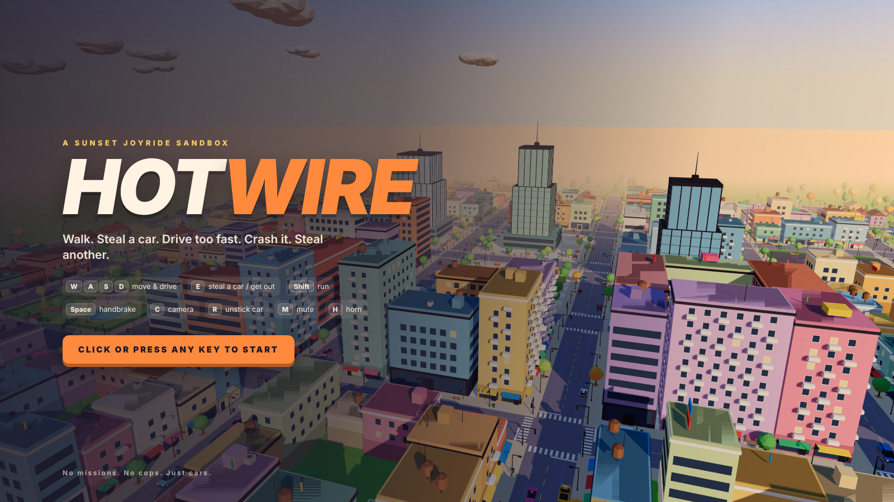

## 02-on-foot.png

On foot on the plaza sidewalk, a Marlin parked at the curb

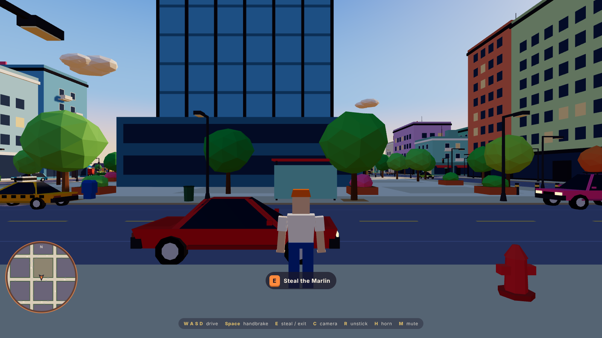

## 03-stolen.png

Just stolen: the card slides in, the engine is running

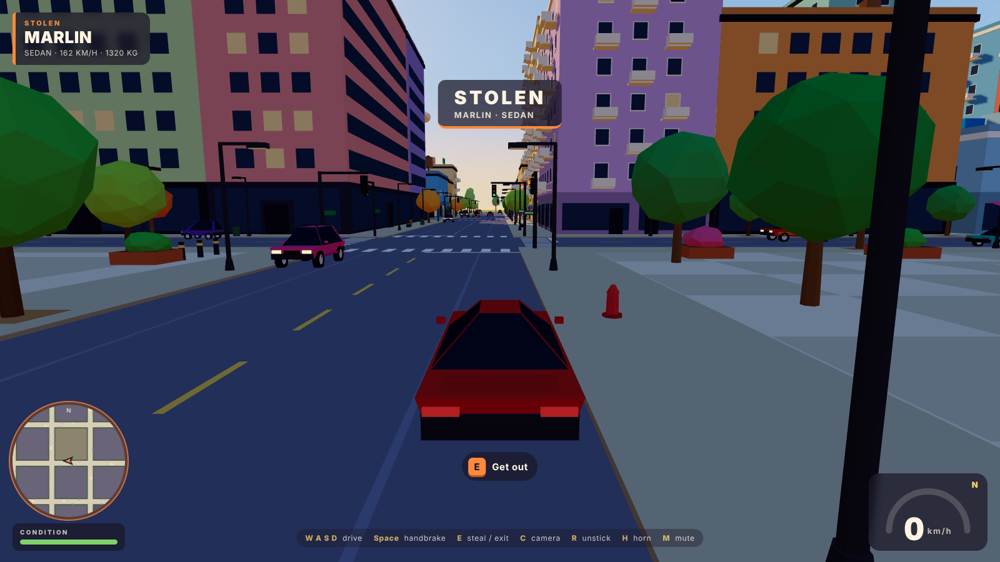

## 04-speed.png

Flat out down the avenue, chase camera widening with speed

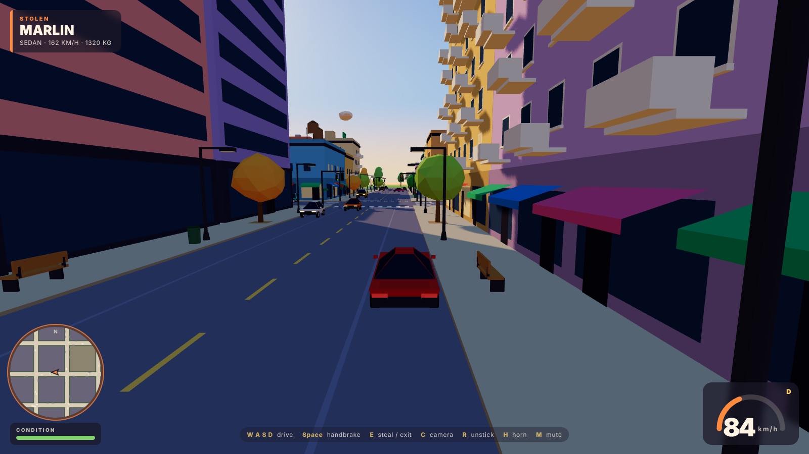

## 05-drift.png

Handbrake through the intersection, skid marks and tire smoke

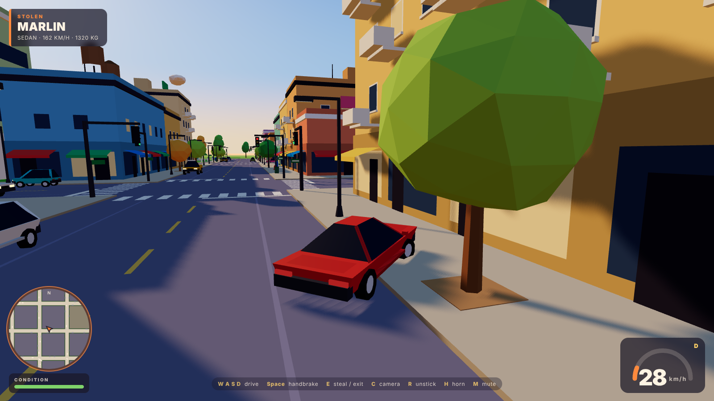

## 06-crash.png

The moment of impact: sparks, debris, the body dents

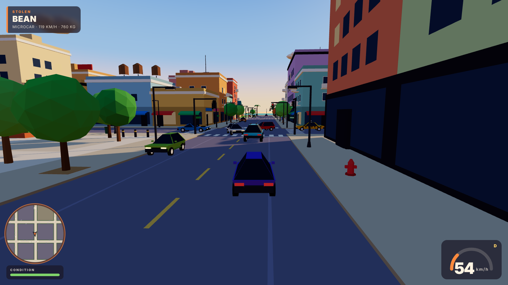

## 07-wrecked.png

Wrecked: charred body, fire and smoke, time to find another ride

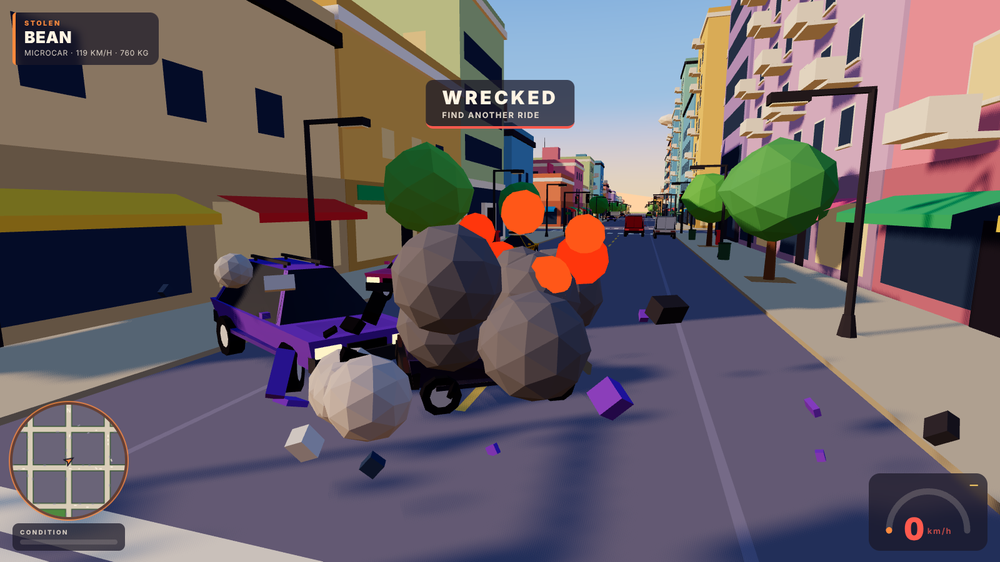

## 08-walk-away.png

Back on foot, the wreck still burning, hunting for the next car

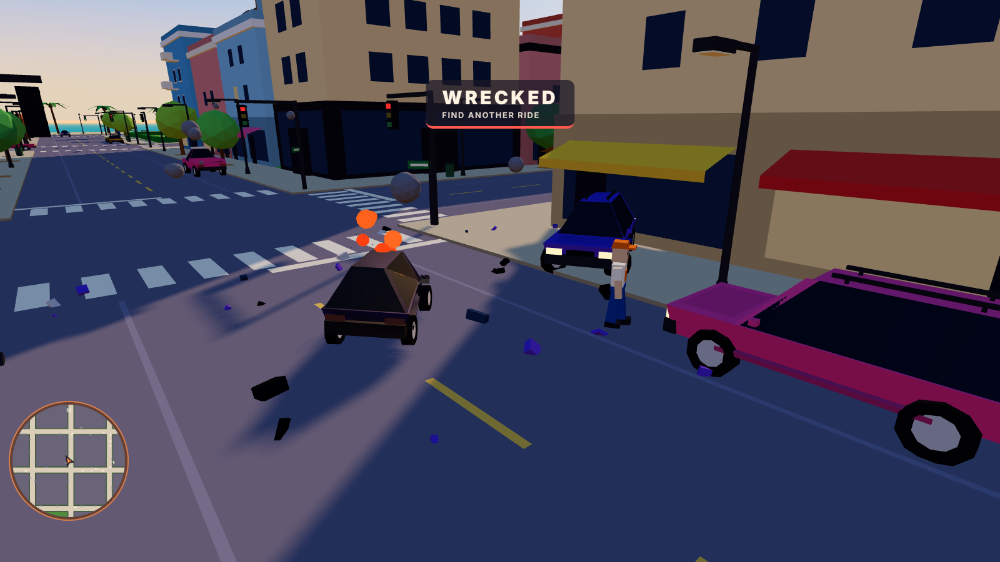

## 09-next-ride.png

A new ride through traffic, the loop continues

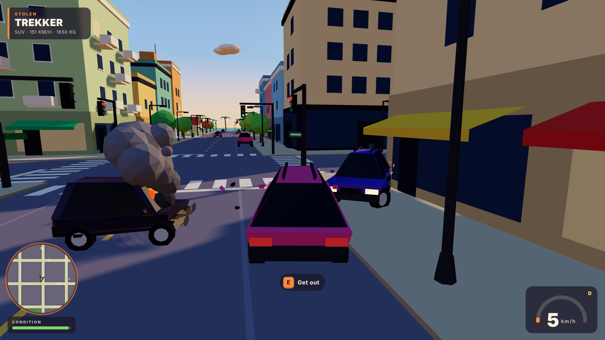

## 10-overview.png

Downtown from above: the grid, the towers, the traffic

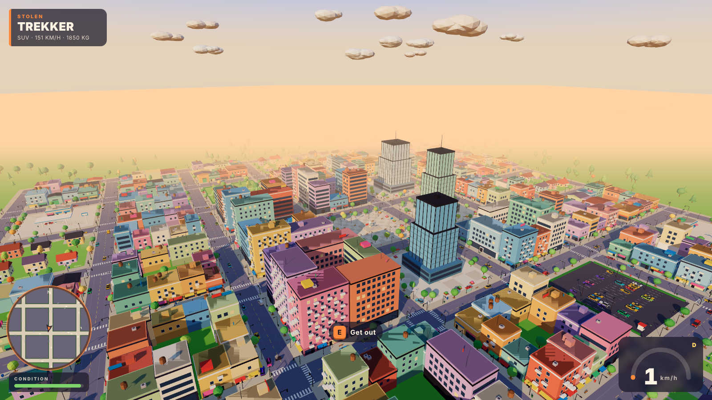

## 11-beach.png

The waterfront: promenade, palms, pier and the sea

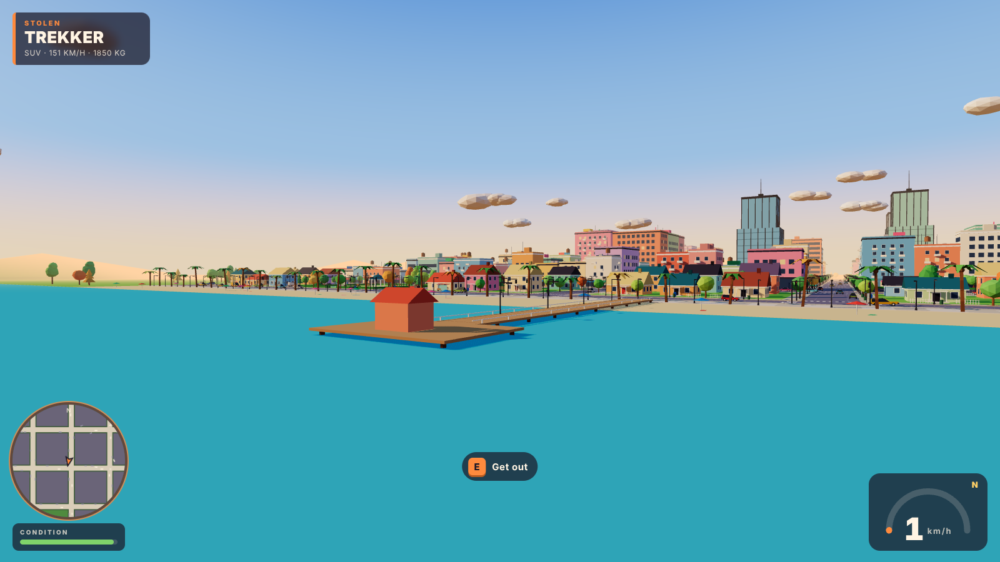

## 12-street.png

Street level at golden hour: long shadows, flat color, clean silhouettes

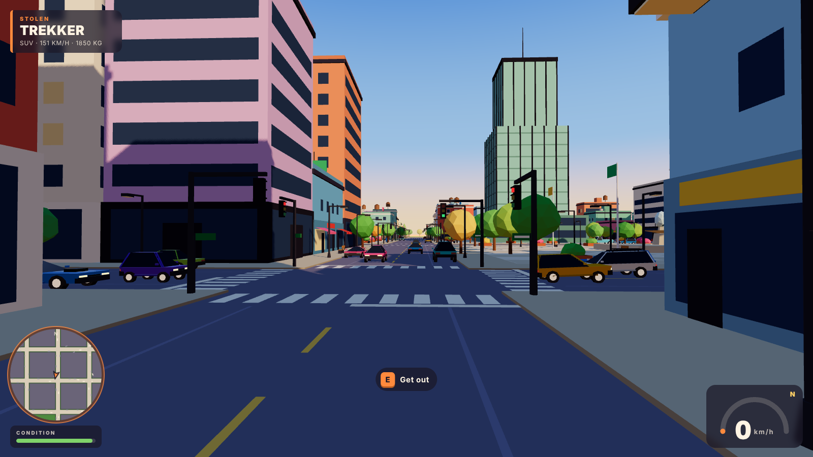

## Session stats

```json
{
  "crashes": 19,
  "smashed": 3,
  "wrecks": 1,
  "stolen": 4,
  "topKmh": 84.2446417177064,
  "tris": 238894,
  "colliders": 1348,
  "props": 1362,
  "parking": 443,
  "lanes": 224,
  "vehicles": 312,
  "buildMs": 386,
  "draws": 330,
  "triangles": 812756,
  "finalState": "car",
  "errors": []
}
```
